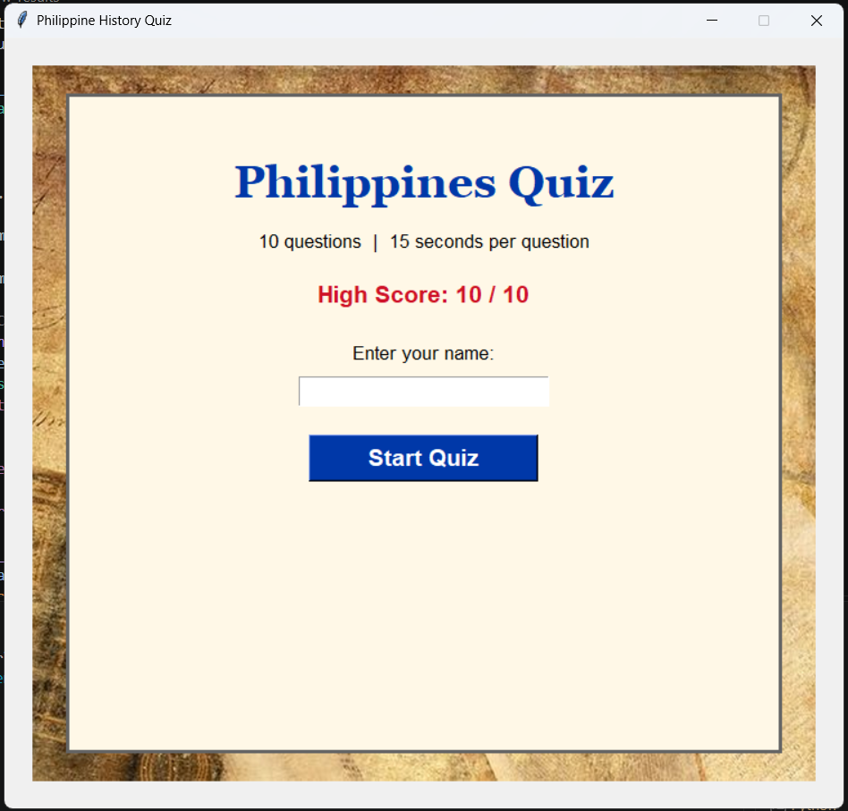
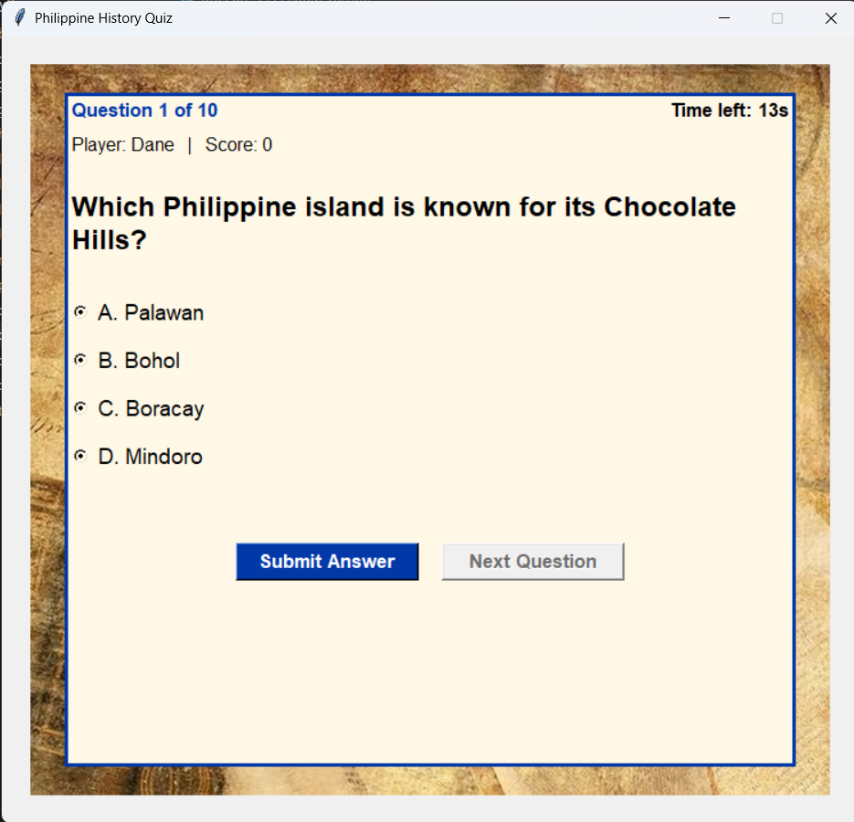
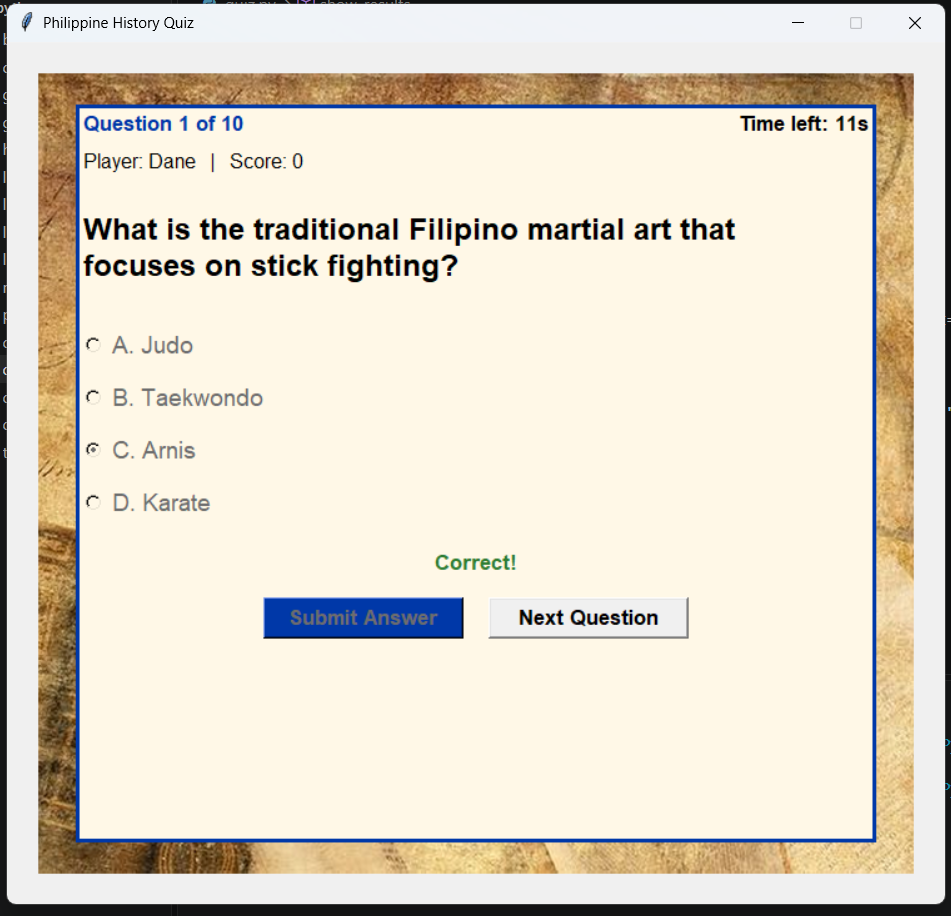
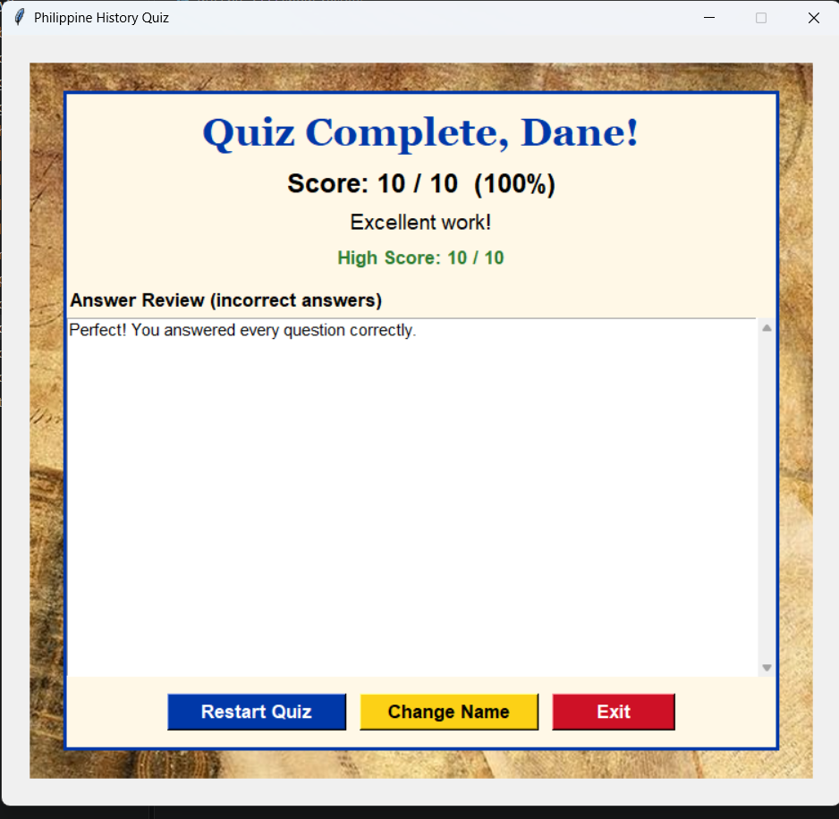
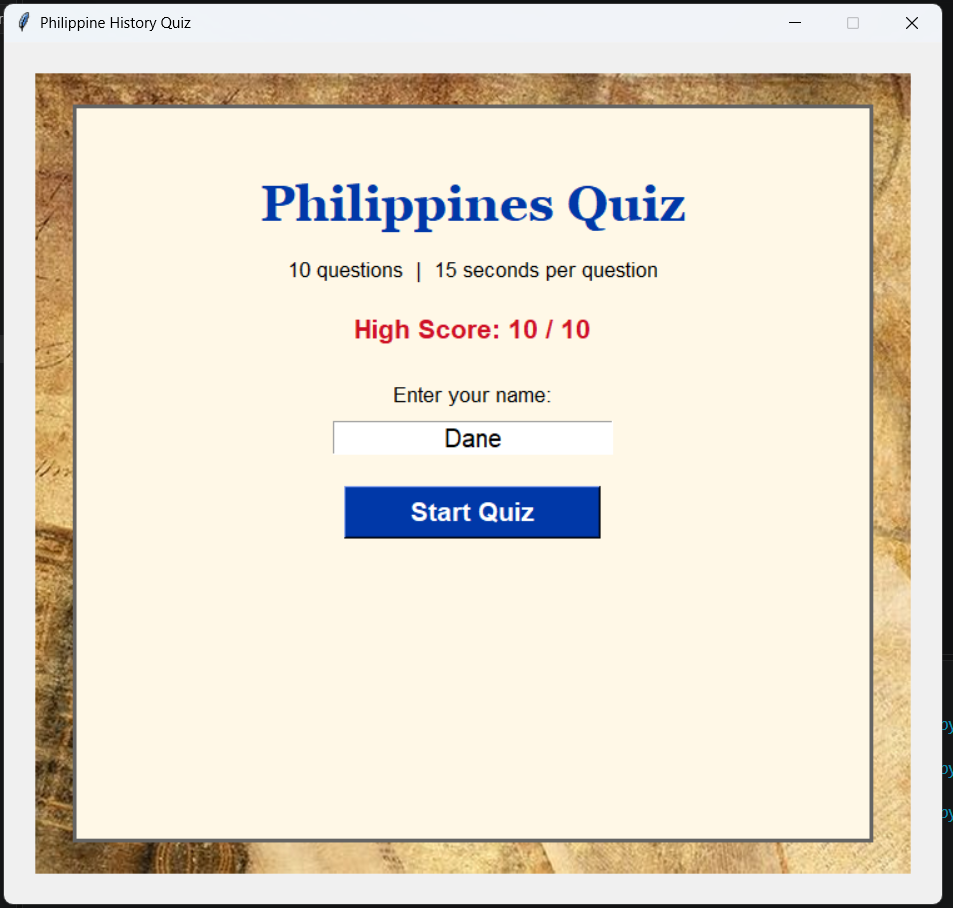

# Philippine History Quiz
 
**Name:** Daniel Ann J. Nervar
**Section:** A
**Topic:** It is all about Philippine History
 
## Features Completed
✔ Name Entry
✔10 multiple-choice questions
✔	Random question order
✔ 15-second countdown timer
✔	Answer checking and time-out handling
✔	Score and percentage
✔	Answer review
✔	High score saved in a text file
✔	Restart button
 
## How the Questions Are Stored and Shuffled
The questions are stored in a list called QUESTIONS. Each question is a dictionary with three keys: "question" (the text), "choices" (a list of four choices labeled A to D), and "answer" (the letter of the correct choice). There are 10 dictionaries in the list for the ten questions.
When the quiz starts or restarts, start_quiz() uses random.sample(QUESTIONS, len(QUESTIONS)). This makes a new shuffled copy and leaves the original QUESTIONS list unchanged, making the order different in every round.
 
## How the Timer Works
Every question gets TIME_LIMIT = 15 seconds. show_question() sets time_left to 15 and then calls update_timer(). That function shows "Time left" on the screen, and the text turns red in the last 5 seconds. If time_left is 0 it calls time_up(). Otherwise it subtracts 1 and uses root.after(1000, update_timer) to call itself again after one second. The id from root.after() is saved in timer_job.

The timer stops in three ways:
- When the player submits, submit_answer() calls stop_timer(), which cancels the scheduled call with root.after_cancel(timer_job).
- update_timer() returns immediately if answered is True.
- When the window is closed, on_close() stops the timer before root.destroy().
 
## How the Program Identifies the Correct Answer
Each choice starts with its letter, such as "B. Filipino". When a question is shown, each radio button gets the first character of its choice (choice[0]) as its value. When the player picks a choice, selected_answer holds that letter ("A", "B", "C" or "D"). On submit, submit_answer() compares it with question["answer"]. If they match, the answer is correct. If not, it is wrong. If nothing is selected, a warning appears and the question is not marked.
 
## How the Score and High Score Work
The score starts at 0 and goes up by 1 for each correct answer. A wrong answer or a time-out adds nothing. At the end, show_results() calculates the percentage with (score / total) * 100. It then picks a message with if / elif / else: 90% or more is "Excellent work!", 70% or more is "Good job!", 50% or more is "Not bad. Keep practicing!", and anything lower is "Review the topic and try again."
The high score is saved in high_score.txt, in the same folder as quiz.py. get_high_score() opens the file, reads the number and converts it with int(). If the file is missing or has invalid text, it returns 0. save_high_score() is called in show_results(). It compares the new score with the saved one and writes the new score to the file only if it is higher. It returns True for a new record, which makes the results screen show "New high score!". The file stays after the program closes, so the start screen shows the high score again when it is reopened.
 
## Function Explanations
| Function | Purpose | Called when |
|----------|---------|-------------|
|     show_start_screen()     |  Shows the title, question count, time limit, high score, name box and Start button       |    The program opens, or Change Name is clicked|
| begin_quiz()	| Checks that a name was typed, saves it, then starts the quiz	| Start Quiz is clicked or Enter is pressed
| start_quiz()	| Resets score, question number and wrong answers, and shuffles the questions	| After begin_quiz(), or when Restart is clicked
| show_question()	| Builds the question screen with the progress label, timer, choices, and Submit and Next buttons	| A question is displayed
| update_timer()	| Shows the time left and counts down every second	| A question is displayed, then once per second
| stop_timer()	| Cancels the scheduled timer	| An answer is submitted, time is up, or the window closes
| submit_answer()	| Checks the answer, updates the score, blocks double submission, and shows feedback	| Submit Answer is clicked
| time_up()	| Marks the question wrong as "No answer (time is up)" and shows the correct answer	| The timer reaches 0
| next_question()	| Moves to the next question, or to the results after question 10	| Next Question or See Results is clicked
| show_results()	| Shows the score, percentage, message, high score status and answer review	| After question 10
| get_high_score()	| Reads the saved high score from the text file	| The start screen or results screen is shown
| save_high_score()	| Writes the score to the file only if it is higher than the old one	| The results screen is shown
| restart_quiz()	| Starts a new round with the same name	| Restart Quiz is clicked
| on_close()	| Stops the timer and closes the window	| Exit is clicked or the window is closed 

## Screenshots

## Challenges I Faced
The hardest part was the timer. At first I did not know how to make the
countdown work without freezing the window. I learned that root.after()
can call a function again every second, and that I must cancel it with
root.after_cancel() when the player submits an answer. Another problem was
that my background image could not be found. I fixed it by putting
background.png in the same folder as quiz.py.
